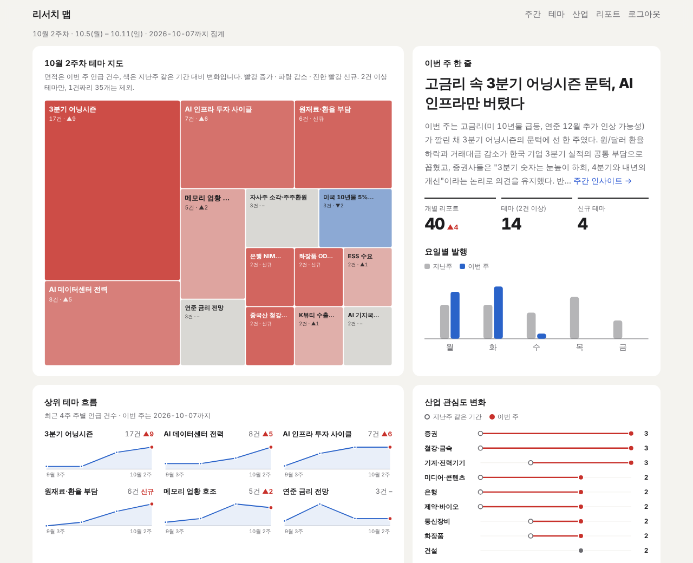
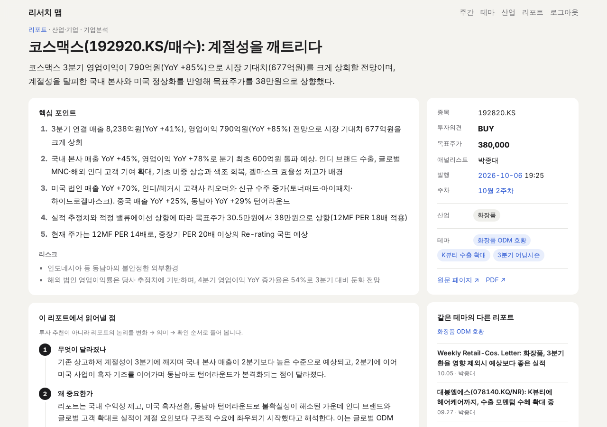

# 리서치 맵

증권사 리서치 리포트를 모아 테마와 산업별로 시장의 흐름을 살펴보는 개인용 대시보드.



## 왜 만들었나

그룹포탈에는 매일 많은 리서치 자료가 올라온다. 모두 읽기에는 시간이 부족했고,
읽어도 핵심을 정리하기가 쉽지 않았다. 궁금했던 것은 “매수”, “매도”라는 의견보다
그 의견에 이르는 논리였다. 무엇이 달라졌고, 왜 그렇게 보는지 알고 싶었다.

리서치 맵은 증권사 보고서를 요약하고, 여러 보고서를 테마와 산업별로 묶어 시장의
흐름을 보여준다. 개별 보고서의 세부 내용과 시장 전체의 흐름 사이를 오가며 읽는 도구다.
애널리스트의 정보가 이미 주가에 반영돼 있더라도, 배경을 이해하는 일이 시간이 지나며
도움이 될 것이라는 생각에서 시작했다.

```text
리포트 원문 → 요약·분류 → 테마·산업별 종합 → 주간·일간 흐름 → 대시보드
```

## 무엇을 볼 수 있나

- **일간 다이제스트**: 오늘의 한 줄과 핵심 3개를 쉬운 말로 읽는다.
- **홈·주간 인사이트**: 테마 지도와 주간 흐름, 테마별 증권사의 시각을 살펴본다.
- **테마·산업**: 관심이 몇 주에 걸쳐 어떻게 변했는지, 어떤 산업에서 나온 이슈인지 확인한다.
- **리포트 상세**: 핵심 포인트와 변화·의미·확인할 점을 읽고 원문으로 이어간다.
  AI 논리 평가는 근거에서 결론까지 이어지는 논리의 강점과 약점을 짚는다.



매수·매도 추천이나 목표주가 예측은 하지 않는다. 시장의 흐름을 이해하고 공부하기 위한
도구이며, 투자 판단의 근거로 삼기 위한 것은 아니다.

## 현재 범위와 한계

지금은 하나증권 리포트만 수집한다. 한 증권사의 시각에 치우칠 수 있고, 리서치 보고서의
매수 의견 쏠림도 그대로 이어질 수 있다. AI 논리 평가로 이를 보완하고, 앞으로는 국내외
증권사를 추가해 같은 종목과 테마를 어떻게 다르게 보는지 비교할 예정이다.

수집·요약·분류, 리포트별 인사이트, 주간 인사이트·산업 브리핑·일간 다이제스트,
대시보드와 AI 논리 평가까지 구현했다. 투자의견·목표주가 변화 추적과 처리량 증가에 따른
비용·저장 구조 정리는 앞으로의 과제다.

## 동작 방식

상시 서버 없이 GitHub Actions로 수집·가공 작업을 실행하고, 결과는 git 커밋으로 남긴다.
`main`에 커밋이 올라오면 Vercel이 대시보드를 다시 빌드한다.

```
daily-pipeline (평일 KST 09·12·18시)
  수집: 하나증권 전체 리서치 피드에서 새 리포트만 → PDF 텍스트 추출(메모리에서만) → 커밋
        │ 성공하면
        ▼
process-reports
  요약·리포트별 인사이트·산업/테마 태깅 → 테마 이름 병합
  → 산업 브리핑(그 주 2건 이상 산업) → 주간 인사이트 → 일간 다이제스트 → 커밋
        │
        ▼
Vercel 재빌드 → 대시보드 (로그인 뒤)
        │ 리포트 상세의 "AI 평가" 버튼
        ▼
evaluate-reports (그 리포트만) → Opus로 논리 평가 → 커밋 → 재빌드
```

- 각 단계의 규칙은 `skills/*/SKILL.md`에 있고, 이 파일을 프롬프트에 그대로 넣어 따르게 한다.
- LLM은 Claude Code CLI(`claude -p`, 도구 비활성화)를 로그인 토큰으로 호출한다.
  파이썬 스크립트가 파일 입출력을 맡고, LLM과는 텍스트만 주고받는다.

PDF는 내려받아 메모리에서 텍스트만 추출하고 버린다. 수집·가공 결과는 데이터베이스 대신
저장소의 JSON·Markdown 파일로 관리한다. 증권사별 수집기는 `scripts/collectors/`에서 분리한다.

## 설정

### GitHub (Settings → Secrets and variables → Actions)

| 종류 | 이름 | 설명 |
|---|---|---|
| Secret | `CLAUDE_CODE_OAUTH_TOKEN` | 필수. 로컬에서 `claude setup-token` 실행 결과 (`sk-ant-oat01-…`) |
| Variable | `CLAUDE_MODEL` | 선택. 요약·태깅·브리핑 모델. 비우면 계정 기본값 |
| Variable | `CLAUDE_REVIEW_MODEL` | 선택. AI 논리 평가 모델. 비우면 `claude-opus-5-5` |

### Vercel

1. Add New → Project → 이 저장소 Import
2. **Root Directory: `web`**, 그 아래 **"Include files outside of the Root Directory in the
   Build Step"** 켜기 (빌드가 `../data` 등을 읽는다)
3. Environment Variables

| 이름 | 설명 |
|---|---|
| `DASHBOARD_PASSWORD` | 필수. 접속 비밀번호. 없으면 사이트가 503을 낸다 |
| `DASHBOARD_USER` | 선택. 접속 아이디, 기본 `me` |
| `DASHBOARD_SECRET` | 선택. 세션 서명 키. 없으면 아이디·비밀번호에서 만든다 (비밀번호를 바꾸면 세션이 모두 끊김) |
| `GITHUB_DISPATCH_TOKEN` | 선택. "AI 평가" 버튼용 Fine-grained PAT. **이 저장소만, Actions: Read and write**. 없으면 버튼이 비활성화된다 |
| `GITHUB_REPO`, `GITHUB_REF` | 선택. 기본 `YUJAEYUN/f_report`, `main` |

환경변수를 바꾼 뒤에는 Deployments에서 Redeploy해야 반영된다.

## 운영

### process-reports 수동 실행 (Actions → process-reports → Run workflow)

| 입력 | 쓰는 때 |
|---|---|
| `limit` | 한 번에 처리할 리포트 수 (기본 30). 밀린 리포트가 많을 때 키운다 |
| `redo_date` | 그 발행일의 브리핑·주간 인사이트·다이제스트만 다시 만들 때 (`limit=0`과 함께) |
| `retag` | 분류 체계(`config/taxonomy.json`)를 바꿨을 때. 전체 재태깅 + 전체 재생성 |
| `redo_all` | 프롬프트(`skills/*`)만 바꿨을 때. 재태깅 없이 테마 병합 + 전체 재생성 |
| `backfill_insights` | 기존 요약·분류는 두고 빠진 리포트별 인사이트만 채울 때. 먼저 `limit=5`로 품질 확인 |

인증 실패(401)나 사용량 한도(429)면 바로, 그 외 오류는 연속 3회면 멈춘다. 그때까지의 결과는
커밋하고 잡은 실패로 표시하며, 남은 리포트는 다음 실행에서 이어서 처리한다.

### AI 논리 평가 (evaluate-reports)

- 리포트 상세의 **AI 평가 생성 / 다시 평가** 버튼이 그 리포트만 대상으로 워크플로를 실행한다.
  평가(1~3분) → 커밋 → Vercel 재빌드 후 반영된다.
- 자동으로 전체를 평가하지 않는다. Actions에서 직접 실행할 때도 `report_ids`나 `date`가 필요하다.
- 평가 기준은 `skills/evaluate-report-claims/SKILL.md`이고, 파일 전체가 시스템 프롬프트로 들어간다.
- 로컬: `python scripts/evaluate_reports.py --ids hana_1288828 --redo` (로그인된 claude CLI 필요)

## 데이터

### 산출물

| 경로 | 내용 |
|---|---|
| `data/reports/{발행일}/hana_{번호}.json` | 리포트 1건 (메타데이터, 원문 텍스트, 요약, 인사이트, 분류, AI 평가) |
| `insights/weekly/{ISO주차}.md` (+`.json`) | 주간 인사이트: 이번 주 한 줄 / 한눈에 / 테마 Top 3~5 / 산업 흐름 / 다음 주 체크포인트 |
| `digest/{발행일}.md` | 일간 다이제스트 (쉬운 말): 오늘 한 줄 / 핵심 3개 / 용어 풀이 / 데일리 코멘트 / 산업별 브리핑 |
| `data/industries/{산업}/briefs/{ISO주차}.md` | 그 주 리포트 2건 이상인 산업의 브리핑 |
| `data/themes/index.json`, `aliases.json` | 테마별 report_id, 병합된 테마 이름 → 대표 이름 |

리포트 데이터에는 수집 메타데이터와 원문 텍스트, 요약·인사이트·분류, AI 논리 평가가
담긴다. PDF 추출에 실패하면 `pdf_error`를 남기고 다음 실행에서 다시 시도한다.
`daily_series`(Hana Guru Eye 등)는 개별 이슈를 이미 종합한 자료이므로, 개별 리포트와
섞어 집계하지 않는다.

분류 체계는 `config/taxonomy.json`에 있다. `desk`는 리포트 성격, `industries`는 주제로
다룬 산업 0~2개, `themes`는 산업을 가로지르는 이슈 1~3개다. 같은 이슈의 다른 이름은
테마 병합 단계에서 하나로 묶는다.

## 주의사항

- 대상 사이트의 robots.txt는 Googlebot·Yeti 외 자동 접근을 막고 있다. 요청 사이에는
  1.5초 간격을 둔다. 정기 실행을 멈추려면 `daily-pipeline.yml`의 `schedule:` 블록을 주석 처리한다.
- `pdf_text`에 리포트 원문이 들어간다. **저장소는 private으로 두고**, 대시보드도
  `DASHBOARD_PASSWORD` 없이 공개 배포하지 않는다.

## 디렉터리 구조

```
skills/                     파이프라인 단계별 규칙 (SKILL.md)
scripts/
  collectors/base.py        수집기 공통 인터페이스
  collectors/hana.py        하나증권 어댑터
  pdf_extract.py            PDF → 텍스트 (메모리 전용)
  report_index.py           수집 완료 인덱스로 중복 방지
  run_pipeline.py           수집 → 추출
  process_reports.py        요약 → 태깅 → 테마 병합 → 브리핑 → 주간 인사이트 → 다이제스트
  evaluate_reports.py       AI 논리 평가
  llm.py                    Claude Code CLI 호출 래퍼
data/                       리포트, 산업 브리핑, 테마 인덱스
insights/weekly/            주간 인사이트
digest/                     일간 다이제스트
config/taxonomy.json        desk 매핑 + 산업 목록
web/                        대시보드 (Next.js, Vercel)
.github/workflows/          daily-pipeline, process-reports, evaluate-reports
```

## 로컬 실행

```bash
pip install -r requirements.txt
python scripts/run_pipeline.py --max-pages 3              # 최근 30건까지 수집
python scripts/run_pipeline.py --max-pages 3 --skip-pdf   # 메타데이터만
python scripts/process_reports.py --limit 5               # 가공 (로그인된 claude CLI 필요)
python -m unittest discover -s tests                      # 테스트

cd web && npm install && npm run dev                      # 대시보드 (개발 모드는 비밀번호 없이 열림)
```
첫 수집은 `--max-pages`만큼 과거로 거슬러 올라가고, 이후에는 이미 본 리포트만 있는 페이지가
나오면 멈춘다.

## 참고 문서

- [`spec.md`](spec.md): 데이터 계약, 화면 요구사항, 테스트·완료 조건
- [`docs/dashboard-visualization-plan.md`](docs/dashboard-visualization-plan.md): 시각화 확장 방향
- [`docs/dashboard-benchmark.md`](docs/dashboard-benchmark.md): 유사 서비스에서 차용·제외한 패턴
- [`docs/report-insight-next-step-prompt.md`](docs/report-insight-next-step-prompt.md): 리포트별 인사이트 작업 프롬프트
